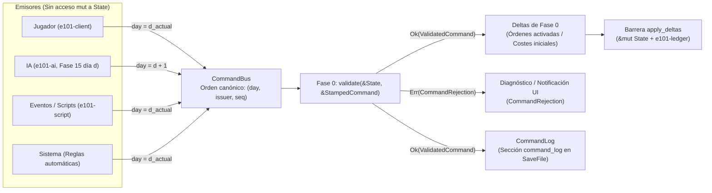

# Especificación del sistema: Comandos, validación y diario de reproducción (`e101-commands`)

> **Estado:** Aprobado para implementación (Fase 1 — Cimientos del motor, `T-108`)
> **Crates afectados:** `e101-commands`, `e101-sim`, `e101-ai`, `e101-script`, `e101-save`, `e101-ledger`, `e101-client`
> **Referencias del Documento Maestro (`v0.7`):** §§ 10 (Economía y producción), 11 (Política e instituciones), 12 (Diplomacia y tratados), 13 (Guerra y logística), 17 (Eventos e historia condicional), 21 (Arquitectura técnica de 101 Engine), 22 (Herramientas, guardado y telemetría), 23 (Pruebas y aseguramiento de calidad); Anexos B ( Decisiones de diseño `D-007`, `D-017`), P (Criterios de aseguramiento de calidad), T (Catálogo de tareas `T-108`), X (Contratos de código y API de crates), AG (Plantilla de especificación de sistema), AI (Tabla maestra de parámetros iniciales), AM (Contrato de observación y emisión de la IA), AR (Especificación del formato de archivo de guardado).
> **ADR relacionados:** [ADR 0001](../adr/0001-monorepo-and-crate-graph.md) (Monorepo y grafo de crates), [ADR 0002](../adr/0002-determinism-rules.md) (Reglas de determinismo y colecciones), [ADR 0003](../adr/0003-fixed-point-types.md) (Tipos de punto fijo), [ADR 0004](../adr/0004-tick-schedule-and-state-hash.md) (Calendario del tick en 18 fases y orden canónico de comandos).

---

## 1. Objetivo

Definir el contrato único de entrada de decisiones al motor de simulación **101 Engine** bajo el principio inquebrantable de **«Comandos, no mutaciones»** (`AGENTS.md` § 2.2, Documento Maestro § 21, `D-007`, `D-017`).

Ningún agente externo ni subsistema de decisión de alto nivel —sea la interfaz del jugador en `e101-client`, los agentes de inteligencia artificial en `e101-ai`, las resoluciones de eventos en `e101-script` o las herramientas de automatización en `101 Forge` y `101 Lab`— puede mutar el estado de la simulación (`State`) de forma directa. Toda intención de cambio debe expresarse como un valor inmutable `Command`, sellarse con metadatos temporales y de autoría dentro de un `StampedCommand`, ordenarse según la tupla canónica `(day, issuer, seq)` ([ADR 0004](../adr/0004-tick-schedule-and-state-hash.md)), validarse sin pánicos en la **Fase 0** del pipeline diario contra `&State` y registrarse en un diario determinista (`CommandLog`) que garantice la reproducción bit a bit (`replay`) de cualquier campaña desde su semilla inicial (§§ 21, 22, 23; Anexos X y AR).

---

## 2. Alcance y fuera de alcance

### 2.1. Dentro del alcance

1. **Catálogo tipado de comandos (`Command`):** definición en Rust de las variantes canónicas del Anexo X (líneas 8465–8476) y de las variantes operativas requeridas para cubrir los bucles jugables de las Fases 1 a 3 del proyecto (§§ 10, 11, 12, 13, 17).
2. **Sellado y autoría (`Issuer`, `StampedCommand`):** identificación inequívoca del emisor, día de ejecución previsto y número de secuencia monótono por emisor y día.
3. **Cola de admisión y ordenación canónica (`CommandBus`):** recepción de comandos desde múltiples fuentes, imposición de la regla temporal `d -> d+1` para la IA (§ 21 línea 4730, Anexo AM) y ordenación total por `(day, issuer, seq)` ([ADR 0004](../adr/0004-tick-schedule-and-state-hash.md)).
4. **Validación pura en Fase 0 (`validate`):** verificación exhaustiva de precondiciones contra `&State` sin efectos secundarios ni llamadas a `panic!`, devolviendo `Result<ValidatedCommand, CommandRejection>` (Anexo X línea 8571).
5. **Diario de comandos y reproducción (`CommandLog`, `replay`):** estructura en memoria indexada por día, contrato de re-ejecución determinista (`T-108`, Anexo X líneas 8539–8553) y serialización binaria en la sección `command_log` de los archivos de guardado (Anexo AR línea 9791).

### 2.2. Fuera de alcance

1. **Cálculo de efectos continuos de simulación:** la resolución económica, demográfica, militar o diplomática derivada de las órdenes activas ocurre en las Fases 1 a 13 del tick (`e101-sim`), no en `e101-commands`.
2. **Heurísticas de utilidad y toma de decisiones de la IA:** el proceso cognitivo que decide *qué* comando emitir pertenece a `e101-ai` (Fase 15, Anexo AM); `e101-commands` solo define el formato del comando y valida su sello temporal.
3. **Transporte de red o sincronización multijugador:** el protocolo de transporte no forma parte del alcance actual; sin embargo, el diseño de `StampedCommand` y `CommandLog` es directamente compatible con arquitecturas *lockstep* deterministas.
4. **Comandos de depuración o edición en caliente de `101 Forge`:** las herramientas de autoría que reescriben escenarios fuera de una partida regulada operan sobre instantáneas de datos en `e101-content` y no usan el `CommandLog` de partida.

---

## 3. Modelo

### 3.1. Principio arquitectónico: «Comandos, no mutaciones»

El flujo de datos entre emisores y el estado persistente cumple estrictamente el ciclo en dos etapas descrito en el Documento Maestro (§ 21, línea 4711) y en [ADR 0004](../adr/0004-tick-schedule-and-state-hash.md):



1. **Aislamiento de lectura:** todos los sistemas y emisores reciben únicamente referencias inmutables (`&State` o vistas filtradas como `AiObservation` en Anexo AM).
2. **Admisión en Fase 0:** al comenzar el tick del día $d$, la **Fase 0 (Comandos)** extrae del `CommandBus` exclusivamente los `StampedCommand` cuyo campo `day == d`, ya ordenados por `(day, issuer, seq)`.
3. **Traducción a deltas:** cada comando validado se transforma en deltas tipados (`StateDelta`) que registran la nueva orden activa, la modificación estatutaria o el desembolso inicial. La mutación real ocurre únicamente en la barrera `apply_deltas` al cierre de la Fase 0.

### 3.2. Definición de `Issuer` y `StampedCommand`

Siguiendo el contrato de código del Anexo X (línea 8475) y las reglas de colecciones e identificadores deterministas ([ADR 0002](../adr/0002-determinism-rules.md)) y de orden de tick ([ADR 0004](../adr/0004-tick-schedule-and-state-hash.md)):

```rust
use e101_store::fixed::{Money, Ratio};
use e101_store::id::{
    ArmyId, BuildingKindId, EntityId, EventInstanceId, InterestGroupId,
    LawOptionId, ProductionModeId, ProvinceId, TreatyProposalId,
};
use e101_time::Day;
use serde::{Deserialize, Serialize};

/// Origen que emite un comando hacia el núcleo de simulación.
/// El orden de las variantes define la prioridad de desempate en Fase 0 (ADR 0004):
/// Player < Ai < Event < System.
#[derive(Copy, Clone, Debug, PartialEq, Eq, PartialOrd, Ord, Hash, Serialize, Deserialize)]
pub enum Issuer {
    /// Jugador humano controlando una entidad política.
    Player(EntityId),
    /// Agente de IA controlando una entidad política (emitido en Fase 15 del día d-1).
    Ai(EntityId),
    /// Resolución de una instancia de evento histórico o dinámico.
    Event(EventInstanceId),
    /// Comando interno generado por reglas sistémicas de transición.
    System,
}

/// Comando sellado con metadatos de tiempo, emisor y secuencia.
/// Es la unidad atómica de admisión en Fase 0 y de persistencia en `CommandLog`.
#[derive(Clone, Debug, PartialEq, Eq, Serialize, Deserialize)]
pub struct StampedCommand {
    /// Día de simulación en cuya Fase 0 debe validarse y ejecutarse este comando.
    pub day: Day,
    /// Emisor responsable del comando.
    pub issuer: Issuer,
    /// Contador monótono por `(day, issuer)`, comenzando en 0.
    pub seq: u32,
    /// Acción solicitada.
    pub command: Command,
}
```

### 3.3. Catálogo inicial de comandos (`enum Command`)

El catálogo incluye las **5 variantes canónicas del Anexo X** (líneas 8465–8476) más las variantes operativas necesarias para las Fases 1 a 3 del desarrollo (§§ 10, 11, 12, 13, 17 y Anexo AM líneas 9583–9586). Todos los importes monetarios usan `Money` (`i64` en diezmilésimas, [ADR 0003](../adr/0003-fixed-point-types.md)) y todos los identificadores son índices generacionales fuertemente tipados ([ADR 0002](../adr/0002-determinism-rules.md)).

```rust
#[derive(Clone, Debug, PartialEq, Eq, Serialize, Deserialize)]
pub enum Command {
    // =========================================================================
    // 1. Variantes base canónicas (Anexo X, líneas 8465–8476)
    // =========================================================================

    /// Inicia o promulga el cambio de una opción dentro de una categoría legal (§ 11).
    SetLaw {
        entity: EntityId,
        category: LawCategory,
        option: LawOptionId,
    },

    /// Ajusta la asignación monetaria o el tipo objetivo de una partida presupuestaria (§ 10, § 11).
    SetBudget {
        entity: EntityId,
        line: BudgetLine,
        amount: Money,
    },

    /// Ordena a un ejército desplazarse siguiendo una ruta explícita de provincias adyacentes (§ 13).
    MoveArmy {
        army: ArmyId,
        path: Vec<ProvinceId>,
    },

    /// Envía una propuesta formal de tratado diplomático con cláusulas tipadas (§ 12).
    ProposeTreaty {
        from: EntityId,
        to: EntityId,
        clauses: Vec<Clause>,
    },

    /// Selecciona una opción de respuesta ante un evento activo (§ 17).
    ChooseEventOption {
        event: EventInstanceId,
        option: u8,
    },

    // =========================================================================
    // 2. Variantes operativas adicionales (Fases 1–3: §§ 10, 11, 12, 13)
    // =========================================================================

    /// Otorga una concesión política o fiscal a un grupo de interés para ganar apoyo (§ 11).
    OfferConcession {
        entity: EntityId,
        group: InterestGroupId,
        concession: ConcessionKind,
    },

    /// Acepta o rechaza una propuesta de tratado diplomático pendiente (§ 12).
    RespondTreaty {
        treaty_proposal: TreatyProposalId,
        accept: bool,
    },

    /// Declara formalmente la guerra invocando un Casus Belli y objetivos de guerra (§ 12, § 13).
    DeclareWar {
        attacker: EntityId,
        defender: EntityId,
        casus_belli: CasusBelliKind,
        war_goals: Vec<WarGoal>,
    },

    /// Cambia la postura u orden operativa de un ejército (asediar, acantonar, retirada, etc.) (§ 13).
    SetArmyOrder {
        army: ArmyId,
        order: ArmyOrderKind,
    },

    /// Contrata una compañía mercenaria pagando meses de adelanto por una duración pactada (§ 13).
    HireMercenaries {
        employer: EntityId,
        company: EntityId,
        months_advance: u8,
        duration_months: u8,
    },

    /// Ordena construir o ampliar niveles de un edificio productivo o infraestructura (§ 10).
    ConstructBuilding {
        actor: EntityId,
        province: ProvinceId,
        building: BuildingKindId,
        levels: u8,
    },

    /// Cambia el modo de producción técnica de un edificio en una provincia (§ 10).
    ChangeProductionMode {
        actor: EntityId,
        province: ProvinceId,
        building: BuildingKindId,
        mode: ProductionModeId,
    },

    /// Ejecuta una acuñación extraordinaria o altera la ley metálica (devaluación/reforma) (§ 10).
    MintOrDebaseCoin {
        entity: EntityId,
        fineness_delta_bp: i16,
        mint_volume: Money,
    },
}
```

#### Tipos auxiliares del modelo de comandos

```rust
#[derive(Copy, Clone, Debug, PartialEq, Eq, PartialOrd, Ord, Hash, Serialize, Deserialize)]
pub enum LawCategory {
    Succession,
    TaxationAuthority,
    MilitaryService,
    TradePolicy,
    LandTenure,
    ReligiousPolicy,
    Centralization,
}

#[derive(Copy, Clone, Debug, PartialEq, Eq, PartialOrd, Ord, Hash, Serialize, Deserialize)]
pub enum BudgetLine {
    CourtAndAdministration,
    ArmyMaintenance,
    NavyMaintenance,
    Fortifications,
    PublicWorks,
    DebtServiceOverride,
}

#[derive(Clone, Debug, PartialEq, Eq, Serialize, Deserialize)]
pub enum Clause {
    Truce { months: u16 },
    CedeProvince { province: ProvinceId, to: EntityId },
    PayIndemnity { from: EntityId, to: EntityId, amount: Money },
    TradeAccess {beneficiary: EntityId, market_owner: EntityId },
    DefensivePact,
    RecognizeSovereignty { over: ProvinceId, holder: EntityId },
    TributePeriodic { payer: EntityId, receiver: EntityId, monthly: Money, months: u16 },
}

#[derive(Copy, Clone, Debug, PartialEq, Eq, Serialize, Deserialize)]
pub enum ConcessionKind {
    TaxExemptionTemporary { months: u8 },
    CouncilSeatGrant,
    MonopolyCharter,
    AutonomyGuarantee,
}

#[derive(Copy, Clone, Debug, PartialEq, Eq, Serialize, Deserialize)]
pub enum CasusBelliKind {
    DeJureClaim(ProvinceId),
    BrokenTreaty(TreatyProposalId),
    TradeDispute,
    DefensiveCallToArms,
    BorderRaidRetaliation,
}

#[derive(Clone, Debug, PartialEq, Eq, Serialize, Deserialize)]
pub enum WarGoal {
    ConquerProvince(ProvinceId),
    EnforceTribute { monthly: Money },
    HumiliateRival,
    WarReparations,
}

#[derive(Copy, Clone, Debug, PartialEq, Eq, Serialize, Deserialize)]
pub enum ArmyOrderKind {
    HoldPosition,
    BesiegeProvince,
    ForageSuppplies,
    ForcedMarch,
    DisbandRegulars,
    RetreatToFriendly,
}
```

### 3.4. Orden canónico `(day, issuer, seq)` y regla `d -> d+1` de la IA

De acuerdo con [ADR 0004](../adr/0004-tick-schedule-and-state-hash.md), el Documento Maestro (§ 21, línea 4730; `D-017`) y el Anexo AM (líneas 9583–9586):

1. **Clave de ordenación total:** todos los `StampedCommand` almacenados en el `CommandBus` para un día $d$ se ordenan antes de iniciar la Fase 0 mediante `Ord` sobre la tupla:
   $$\text{Key}(\text{cmd}) = (\text{cmd.day},\ \text{cmd.issuer},\ \text{cmd.seq})$$
   - **`day: Day` (ascendente):** garantiza el procesamiento cronológico estricto.
   - **`issuer: Issuer` (ascendente):** desempata determinísticamente entre emisores distintos en el mismo día según el orden derivado del `enum Issuer`:
     1. `Issuer::Player(entity_id)` ordenado por `EntityId` ascendente.
     2. `Issuer::Ai(entity_id)` ordenado por `EntityId` ascendente.
     3. `Issuer::Event(event_instance_id)` ordenado por `EventInstanceId` ascendente.
     4. `Issuer::System`.
   - **`seq: u32` (ascendente):** contador monótono asignado por el `CommandBus` para cada par `(day, issuer)` comenzando en `0`. Preserva el orden exacto en que un mismo emisor emitió múltiples comandos durante el mismo turno.

2. **Regla estricta `d -> d+1` para la IA:**
   - La **Fase 15 (IA)** se ejecuta al final de los sistemas de simulación del día $d$, leyendo una vista inmutable `AiObservation` del estado resultante del día $d$.
   - Todo comando emitido por `e101-ai` durante la Fase 15 del día $d$ recibe obligatoriamente el sello `day = Day(d.0 + 1)` y `issuer = Issuer::Ai(entity)`.
   - **Prohibición de retroactividad:** si cualquier subsistema intenta encolar un comando de IA con `cmd.day <= current_day` una vez superada la Fase 0 del día `current_day`, el `CommandBus` rechaza la inserción inmediatamente con `BusEnqueueError::RetroactiveAiCommand { current_day, command_day }`.
   - **Comandos del jugador (`Issuer::Player`):** cuando el jugador emite una orden con la simulación en pausa antes de ejecutar el tick del día $d$, o durante la ventana previa a la Fase 0 del próximo tick, el cliente estampa el comando para la Fase 0 del próximo tick a simular. Esto garantiza que humanos e IA operen bajo las mismas reglas de entrada sin carreras de datos.

### 3.5. Validación en Fase 0 (`validate`)

Siguiendo la regla fundamental del Anexo X (línea 8571): **«el núcleo no hace `panic!` ante datos inválidos»**. La Fase 0 ejecuta una función pura de validación para cada `StampedCommand`:

```rust
/// Resultado de validar un comando sellado contra el estado actual en Fase 0.
pub fn validate(
    state: &State,
    stamped: &StampedCommand,
) -> Result<ValidatedCommand, CommandRejection>;

/// Envoltorio con tipo opaco que certifica que el comando superó `validate` en Fase 0.
/// Solo un `ValidatedCommand` puede generar deltas de Fase 0 y añadirse al `CommandLog`.
#[derive(Clone, Debug, PartialEq, Eq)]
pub struct ValidatedCommand {
    stamped: StampedCommand,
}

/// Información estructurada de rechazo devuelta cuando un comando incumple precondiciones.
#[derive(Clone, Debug, PartialEq, Eq, Serialize, Deserialize)]
pub struct CommandRejection {
    pub day: Day,
    pub issuer: Issuer,
    pub seq: u32,
    pub reason: CommandRejectionReason,
}

/// Catálogo tipado de causas de rechazo en Fase 0.
#[derive(Copy, Clone, Debug, PartialEq, Eq, Serialize, Deserialize)]
pub enum CommandRejectionReason {
    /// El `Issuer` no tiene autoridad sobre la entidad, ejército o provincia objetivo.
    UnauthorizedIssuer,
    /// La entidad emisora o receptora no existe o fue anexada/extinguida.
    EntityNotActive,
    /// Algún identificador referenciado (ArmyId, ProvinceId, EventInstanceId, etc.) es inválido o su generación caducó.
    InvalidTargetId,
    /// La ley o partida presupuestaria exige propuesta previa, carece de competencia institucional o tiene una reforma en curso (§ 11).
    CompetenceBlocked,
    /// Ruta militar inválida: provincias no adyacentes en `e101-map`, paso de montaña cerrado por invierno o estrecho bloqueado sin control naval (§ 04, § 13).
    InvalidPath,
    /// El tratado contiene cláusulas mutuamente contradictorias o duplicadas (QA-DIP-01, § 12).
    ContradictoryClauses,
    /// Acción bloqueada por un tiempo de enfriamiento activo (p. ej. `dip.retry.cooldown` o cambio de ley reciente).
    CooldownActive,
    /// El tesoro más el margen de crédito inmediato no cubren el desembolso inicial exigido.
    InsufficientFundsOrCapacity,
    /// Parámetro numérico fuera de banda permitida (p. ej. presupuesto negativo `amount < Money::ZERO`, niveles = 0).
    OutOfRangeValue,
}
```

#### Tabla exhaustiva de comprobaciones en Fase 0 por variante de `Command`

| Variante de `Command` | Comprobaciones obligatorias en `validate(&State, &StampedCommand)` | Códigos de rechazo (`CommandRejectionReason`) |
| :--- | :--- | :--- |
| **`SetLaw`** | 1. `entity` activa en `State`.<br>2. `issuer` autorizado para gobernar `entity`.<br>3. `option` existe en `e101-content` y pertenece a `category`.<br>4. No es la opción ya vigente.<br>5. No hay otra reforma legal en curso ni enfriamiento activo en `category`, y la corona/consejo posee la competencia institucional requerida (§ 11). | `EntityNotActive`, `UnauthorizedIssuer`, `InvalidTargetId`, `CompetenceBlocked`, `CooldownActive` |
| **`SetBudget`** | 1. `entity` activa y `issuer` autorizado.<br>2. `amount >= Money::ZERO` y dentro del techo máximo estatutario.<br>3. La partida `line` no está bloqueada por bancarrota o cláusula institucional (§ 10, § 11). | `EntityNotActive`, `UnauthorizedIssuer`, `OutOfRangeValue`, `CompetenceBlocked` |
| **`MoveArmy`** | 1. `army` existe en el `SlotMap` con generación vigente.<br>2. El propietario de `army` coincide con la entidad del `issuer`.<br>3. `path` no está vacío y su longitud no excede `cmd.max_path_len`.<br>4. Cada par consecutivo $(p_i, p_{i+1})$ es adyacente en `e101-map`, no atraviesa pasos de montaña cerrados por estación invernal y, si cruza un estrecho marítimo, la entidad tiene paso naval libre (§ 13).<br>5. El ejército no está trabado en combate activo sin orden de retirada. | `InvalidTargetId`, `UnauthorizedIssuer`, `OutOfRangeValue`, `InvalidPath`, `CompetenceBlocked` |
| **`ProposeTreaty`** | 1. `from` y `to` son entidades distintas y activas; `issuer` controla `from`.<br>2. `clauses` contiene entre `1` y `cmd.max_treaty_clauses` elementos.<br>3. Ningún par de cláusulas es mutuamente contradictorio (p. ej. ceder la misma provincia a dos receptores o exigir e indemnizar simultáneamente por el mismo concepto, `QA-DIP-01`).<br>4. Ha transcurrido el enfriamiento `dip.retry.cooldown` (6 meses) desde el último rechazo análogo entre `from` y `to` (Anexo AI, § 12). | `EntityNotActive`, `UnauthorizedIssuer`, `OutOfRangeValue`, `ContradictoryClauses`, `CooldownActive` |
| **`ChooseEventOption`** | 1. `event` existe como instancia pendiente en el día actual.<br>2. El destinatario de `event` corresponde al `issuer`.<br>3. El índice `option` existe en la definición del evento y cumple sus guardas condicionales (`e101-script`, § 17). | `InvalidTargetId`, `UnauthorizedIssuer`, `CompetenceBlocked`, `OutOfRangeValue` |
| **`OfferConcession`** | 1. `entity` activa y controlada por `issuer`.<br>2. `group` pertenece a `entity` y está activo.<br>3. La concesión no está ya otorgada ni en periodo de enfriamiento (§ 11). | `EntityNotActive`, `UnauthorizedIssuer`, `InvalidTargetId`, `CooldownActive`, `CompetenceBlocked` |
| **`RespondTreaty`** | 1. `treaty_proposal` existe y aún no ha expirado.<br>2. El destinatario (`to`) de la propuesta coincide con la entidad del `issuer`.<br>3. Si `accept == true`, las condiciones materiales de las cláusulas (provincias poseídas, fondos de indemnización al contado) siguen siendo válidas en el día actual (§ 12). | `InvalidTargetId`, `UnauthorizedIssuer`, `InsufficientFundsOrCapacity`, `CompetenceBlocked` |
| **`DeclareWar`** | 1. `attacker` y `defender` están activos y no están ya en guerra entre sí.<br>2. `issuer` controla `attacker`.<br>3. `casus_belli` es válido y verificable en `State`; `war_goals` no está vacío ni contiene objetivos contradictorios.<br>4. No existe tregua activa inquebrantable o bloqueo regencial que impida declarar la guerra (§ 12, § 13). | `EntityNotActive`, `UnauthorizedIssuer`, `InvalidTargetId`, `ContradictoryClauses`, `CooldownActive`, `CompetenceBlocked` |
| **`SetArmyOrder`** | 1. `army` activo y controlado por la entidad del `issuer`.<br>2. La orden `order` es compatible con el estado de la provincia actual (p. ej. `BesiegeProvince` requiere provincia fortificada hostil; `DisbandRegulars` requiere no estar en combate) (§ 13). | `InvalidTargetId`, `UnauthorizedIssuer`, `CompetenceBlocked` |
| **`HireMercenaries`** | 1. `employer` y `company` existen y están activos; `issuer` controla `employer`.<br>2. `company` es una compañía mercenaria disponible y dentro de alcance logístico.<br>3. `months_advance >= 1` y `duration_months >= months_advance`.<br>4. El tesoro de `employer` (más crédito inmediato si aplica) cubre el adelanto `cost = monthly_rate * months_advance` (§ 13). | `EntityNotActive`, `UnauthorizedIssuer`, `InvalidTargetId`, `OutOfRangeValue`, `InsufficientFundsOrCapacity` |
| **`ConstructBuilding`** | 1. `actor` activo y autorizado por `issuer`.<br>2. `province` existe y `actor` tiene derecho legal de edificación en ella.<br>3. `building` existe en `e101-content`; `levels >= 1` y no supera la capacidad de ranuras o recursos base de la provincia.<br>4. Fondos iniciales disponibles en la tesorería del `actor` (§ 10). | `EntityNotActive`, `UnauthorizedIssuer`, `InvalidTargetId`, `OutOfRangeValue`, `CompetenceBlocked`, `InsufficientFundsOrCapacity` |
| **`ChangeProductionMode`** | 1. `actor` activo y autorizado sobre el edificio `building` en `province`.<br>2. El edificio existe con nivel $\ge 1$ en `province`.<br>3. `mode` es compatible con `building` y está desbloqueado institucional/técnicamente (§ 10). | `EntityNotActive`, `UnauthorizedIssuer`, `InvalidTargetId`, `CompetenceBlocked` |
| **`MintOrDebaseCoin`** | 1. `entity` activa, controlada por `issuer` y poseedora de regalía de acuñación (`CompetenceBlocked` si es vasallo sin ceca).<br>2. `mint_volume >= Money::ZERO` y `fineness_delta_bp` dentro de los límites físicos de la ley metálica.<br>3. No viola el enfriamiento monetario mínimo ni supera el metal disponible cuando `fineness_delta_bp >= 0` (§ 10). | `EntityNotActive`, `UnauthorizedIssuer`, `CompetenceBlocked`, `OutOfRangeValue`, `CooldownActive`, `InsufficientFundsOrCapacity` |

### 3.6. Diario de comandos (`CommandLog`) y reproducción (`replay`)

Para cumplir con la tarea `T-108`, el Anexo X (líneas 8539–8553), el Anexo AR (línea 9791) y el criterio de calidad `QA-CORE-04`, el crate `e101-commands` mantiene un registro inmutable de todos los comandos que devolvieron `Ok(ValidatedCommand)` en la Fase 0.

```rust
/// Diario cronológico e inmutable de todos los comandos validados y aplicados en una partida.
#[derive(Clone, Debug, Default, PartialEq, Eq, Serialize, Deserialize)]
pub struct CommandLog {
    /// Vector plano ordenado estrictamente por `(day, issuer, seq)`.
    entries: Vec<StampedCommand>,
    /// Índice de rangos `(day, start_idx..end_idx)` para búsqueda binaria O(log N) por día.
    day_index: Vec<(Day, u32, u32)>,
}

impl CommandLog {
    /// Registra los comandos validados durante la Fase 0 del día `day`.
    pub fn append_day(&mut self, day: Day, validated: impl IntoIterator<Item = ValidatedCommand>);

    /// Devuelve el slice de comandos ejecutados exactamente en el día `day` en O(log D).
    pub fn commands_for_day(&self, day: Day) -> &[StampedCommand];

    /// Devuelve la totalidad de entradas del diario.
    pub fn as_slice(&self) -> &[StampedCommand];
}

/// Reproduce una partida desde el estado inicial hasta `until` (inclusive) aplicando el diario.
/// Contrato del Anexo X (líneas 8539–8553).
pub fn replay(
    initial: &State,
    log: &[StampedCommand],
    until: Day,
) -> State;
```

#### Formato binario en archivos de guardado (`SaveFile`, Anexo AR)

1. En el archivo de guardado `.e101save` (Anexo AR, línea 9791), el `CommandLog` se almacena en una sección dedicada identificada como `SectionKind::CommandLog` (`command_log`).
2. **Serialización y compresión:** la estructura `CommandLog` se serializa de forma canónica usando `postcard` (con esquema versionado `command_log_version: u16`) y el bloque resultante se comprime con `zstd` (nivel determinista fijo).
3. **Integridad criptográfica:** el directorio de secciones del `SaveFile` guarda el hash **BLAKE3 de 256 bits** de los bytes sin comprimir de `command_log`. Al cargar una partida (`e101-save`), si el hash BLAKE3 no coincide o si el orden `(day, issuer, seq)` no es estrictamente monótono, el cargador rechaza el archivo con error tipado sin entrar en `panic!`.
4. **Informes de error y bisección (`cargo xtask golden --bisect`):** dado el estado inicial de una campaña (`seed`, `content_hash`, fecha de inicio) y la sección `command_log` (que ocupa pocos kilobytes incluso tras siglos de simulación), `101 Lab` y la suite de pruebas pueden reconstruir cualquier tick exacto mediante `replay` y localizar el primer tick y el sistema responsable de una divergencia (`§ 22`, `§ 23`).

---

## 4. Parámetros iniciales

Los límites operativos y tiempos de enfriamiento verificados por `e101-commands` en Fase 0 proceden de la tabla maestra de parámetros (Anexo AI) y de los contratos de validación:

| Parámetro | Clave en datos (`RON`) | Tipo | Valor inicial | Referencia |
| :--- | :--- | :--- | :--- | :--- |
| Enfriamiento tras rechazo de propuesta diplomática | `dip.retry.cooldown` | `u16` (días) | `180` (6 meses) | Anexo AI / § 12 |
| Longitud máxima de ruta en `MoveArmy` | `cmd.max_path_len` | `u16` (provincias) | `64` | § 13 / Anexo X |
| Número máximo de cláusulas en `ProposeTreaty` | `cmd.max_treaty_clauses` | `u8` | `12` | § 12 |
| Número máximo de objetivos en `DeclareWar` | `cmd.max_war_goals` | `u8` | `8` | § 12 / § 13 |
| Límite de comandos por emisor y tick | `cmd.max_per_issuer_per_day` | `u32` | `256` | § 21 / Protección DoS |
| Variación máxima de ley metálica por orden | `econ.mint.max_debase_bp` | `i16` (puntos básicos) | `-2500` a `+2500` | § 10 |

---

## 5. Invariantes

1. **INV-CMD-01 (Inmutabilidad fuera de barrera):** ningún método de `e101-commands` recibe `&mut State`. La validación `validate` es una función pura sin efectos laterales ni acceso a reloj, red o disco (`AGENTS.md` § 3).
2. **INV-CMD-02 (Orden total determinista):** para cualquier conjunto de comandos admitidos para el día $d$, el orden de evaluación en Fase 0 está unívocamente determinado por `(day, issuer, seq)` ([ADR 0004](../adr/0004-tick-schedule-and-state-hash.md)). Dos ejecuciones con los mismos comandos producen exactamente la misma secuencia de evaluación independientemente del hilo o momento en que se encolaron.
3. **INV-CMD-03 ( Causalidad temporal de la IA `d -> d+1`):** ningún comando con `Issuer::Ai(_)` originado durante la Fase 15 del día $d$ puede tener `cmd.day <= d` (§ 21 línea 4730, Anexo AM).
4. **INV-CMD-04 (Ausencia total de `panic!` en validación):** ante cualquier entrada corrupta, ID obsoleto, ruta desconectada o valor fuera de rango, `validate` devuelve `Err(CommandRejection)` y jamás invoca `panic!`, `unwrap()` ni `expect()` sobre datos de entrada (Anexo X línea 8571).
5. **INV-CMD-05 (Pureza del `CommandLog`):** el `CommandLog` de reproducción contiene **única y exclusivamente** los comandos que devolvieron `Ok(ValidatedCommand)` en la Fase 0, grabados en el mismo orden `(day, issuer, seq)` en que se aplicaron. Los comandos rechazados se envían al canal de diagnóstico y no ensucian el `CommandLog`.
6. **INV-CMD-06 (Equivalencia de `replay`):** para cualquier día $d$, ejecutar la simulación en vivo desde el día $0$ hasta $d$ y ejecutar `replay(&initial_state, log.as_slice(), d)` produce un `State` con idéntico hash BLAKE3 bit a bit (`QA-CORE-04`, Anexo X).
7. **INV-CMD-07 (Prohibición de punto flotante):** ningún campo de `Command`, `Clause` o estructuras auxiliares utiliza `f32` o `f64` ([ADR 0003](../adr/0003-fixed-point-types.md)).

---

## 6. Interacción con otros sistemas

| Crate / Fase | Dirección | Contrato de interacción |
| :--- | :--- | :--- |
| **`e101-client` (UI)** | Emisor $\rightarrow$ `CommandBus` | Construye instancias de `Command` a partir de acciones del jugador, consulta `validate` en seco (*dry-run*) para previsualizar en los *tooltips* si el botón está activo o por qué está bloqueado, y encola `StampedCommand` con `Issuer::Player`. Recibe `CommandRejection` si falla en Fase 0. |
| **`e101-ai` (Fase 15)** | Emisor $\rightarrow$ `CommandBus` | Al finalizar la Fase 15 del día $d$, entrega un `Vec<Command>` por entidad controlada por la IA (Anexo AM). El `CommandBus` los sella con `day = d + 1`, `issuer = Issuer::Ai(entity)` y `seq = 0..k`. |
| **`e101-script` (Fase 14)** | Emisor $\rightarrow$ `CommandBus` | Los efectos inmediatos o elecciones de eventos (`ChooseEventOption`) se encolan como comandos con `Issuer::Event(event_id)` o `Issuer::Player(entity)` para resolverse ordenadamente en la Fase 0 correspondiente (§ 17). |
| **`e101-sim` (Fase 0)** | `CommandBus` $\rightarrow$ Deltas | En la Fase 0 del pipeline de 18 fases (`0..=17`, [ADR 0004](../adr/0004-tick-schedule-and-state-hash.md)), `e101-sim` extrae los comandos del día $d$, ejecuta `validate`, transforma cada `ValidatedCommand` en `StateDelta` y los aplica antes de iniciar la Fase 1 (Clima). |
| **`e101-map`** | Consulta en `validate` | `validate` consulta el grafo de adyacencias, el estado estacional de los pasos de montaña y el control de estrechos para validar `MoveArmy` (§ 13). |
| **`e101-ledger` (Fase 16)** | Fase 0 $\rightarrow$ Ledger | Todo comando validado que modifique una variable visible (p. ej. `SetBudget`, `SetLaw`, adelanto de `HireMercenaries`, `MintOrDebaseCoin`) emite un asiento en `e101-ledger` vinculado al `StampedCommand` como causa raíz (`CausalOrigin::Command`). |
| **`e101-save`** | `CommandLog` $\leftrightarrow$ Disco | Serializa y verifica con BLAKE3 la sección `command_log` al guardar o cargar partida, preservando intacto el orden `(day, issuer, seq)` (Anexo AR). |

---

## 7. Registro causal

De acuerdo con `AGENTS.md` (§ 2.4 y § 3) y el Documento Maestro (§ 21), todo cambio en una variable visible para el jugador originado por un comando debe registrar su causa explícita en `e101-ledger`:

1. **Vínculo causal directo (`CausalSource::Command`):** cuando la Fase 0 convierte un `ValidatedCommand` en deltas (por ejemplo, el pago del adelanto en `HireMercenaries`, la alteración de la ley metálica en `MintOrDebaseCoin` o el ajuste de `SetBudget`), el delta incluye la referencia `(day, issuer, seq)` del `StampedCommand`.
2. **Trazabilidad en efectos diferidos:** cuando un comando instala una orden persistente en el estado (p. ej. `MoveArmy` actualiza la ruta activa de un ejército, o `ConstructBuilding` abre una obra en la provincia), la estructura de orden activa conserva el sello `(day, issuer, seq)` que la originó. Así, los gastos de mantenimiento o suministros en las Fases 3 a 8 pueden atribuirse en el desglose del jugador a la orden emitida en dicho día.
3. **Registro de rechazos:** los comandos que devuelven `Err(CommandRejection)` no generan asientos contables en `e101-ledger` (pues no alteran `State`), pero se registran en el buffer de eventos de diagnóstico del tick para informar al jugador o depurar agentes de IA.

---

## 8. Interfaz de usuario

Aunque `e101-commands` no depende de ninguna biblioteca gráfica (`AGENTS.md` § 2.5), expone las funciones necesarias para que `e101-client` cumpla los principios de transparencia del Documento Maestro:

1. **Validación previa en seco (*Dry-Run Validation*):** la interfaz invoca `e101_commands::validate(&client_state_view, &draft_stamped_command)` cada vez que el jugador sitúa el cursor sobre un botón de acción (promulgar ley, proponer tratado, mover ejército, construir edificio).
2. **Tooltips de requisitos y bloqueo:** si `validate` devuelve `Err(CommandRejection)`, el cliente traduce `CommandRejectionReason` mediante los archivos Fluent (`games/epoch/locale/`) a una explicación exacta en el *tooltip* (p. ej., *"Bloqueado (`CooldownActive`): Deben transcurrir 42 días más antes de enviar otra propuesta diplomática a esta entidad"* o *"Ruta inválida (`InvalidPath`): El paso de montaña está cerrado por el invierno"*).
3. **Notificación de rechazo en Fase 0:** si un comando era válido cuando el jugador lo encoló pero las condiciones cambiaron antes de su ejecución en Fase 0, la UI muestra una notificación no intrusiva indicando el comando descartado y su `CommandRejectionReason`.

---

## 9. Pruebas y escenarios

Las pruebas de `e101-commands` son obligatorias antes de dar por completada `T-108` (`cargo xtask test e101-commands` y `cargo xtask golden`):

1. **Pruebas unitarias de ordenación canónica (`test_canonical_command_order`):**
   - Insertar en orden aleatorio (permutaciones pseudoaleatorias) un lote de 100 comandos con distintos `Day`, `Issuer` (`Player`, `Ai`, `Event`, `System`) y `seq`.
   - Comprobar que la salida del `CommandBus` para cada día produce siempre la misma secuencia exacta ordenada por `(day, issuer, seq)` ([ADR 0004](../adr/0004-tick-schedule-and-state-hash.md)).
2. **Pruebas del contrato `d -> d+1` de la IA (`test_ai_command_day_shift`):**
   - Verificar que todo comando emitido por `e101-ai` en la Fase 15 del día $d$ se estampa con `Day(d.0 + 1)` y se ejecuta en la Fase 0 del día $d+1$.
   - Verificar que intentar encolar un comando `Issuer::Ai` con `day <= d` tras la Fase 0 devuelve `Err(BusEnqueueError::RetroactiveAiCommand)`.
3. **Pruebas exhaustivas de rechazo sin pánico (`test_validate_never_panics` + *property testing*):**
   - Generar mediante `proptest` comandos arbitrarios con IDs inexistentes, generaciones caducadas en el `SlotMap`, importes `Money::MIN`, rutas `MoveArmy` vacías o desconectadas y cláusulas contradictorias (`QA-DIP-01`).
   - Verificar que `validate` devuelve siempre `Err(CommandRejection)` con la variante `CommandRejectionReason` esperada y jamás hace `panic!` (Anexo X línea 8571).
4. **Prueba de determinismo y reproducción (`test_command_log_replay_bit_exact`, `QA-CORE-04`):**
   - Ejecutar un escenario de 365 ticks con comandos intercalados de jugador, IA y eventos; capturar el estado final `state_live` y el `CommandLog`.
   - Ejecutar `let state_replayed = replay(&initial_state, log.as_slice(), Day(365));`.
   - Comprobar que `state_live.blake3_hash() == state_replayed.blake3_hash()`.
5. **Prueba de persistencia en guardado (`test_save_reload_preserves_command_log`):**
   - Serializar el `CommandLog` con `postcard` + `zstd`, verificar su hash BLAKE3, recargarlo en memoria y comprobar que el orden y contenido son idénticos y que `replay` tras la recarga produce el mismo hash de estado.

---

## 10. Preguntas abiertas

- **`Abierto` — Resolución de múltiples comandos del mismo emisor en el mismo tick que compiten por el mismo saldo de tesorería (`seq = 0` y `seq = 1`):**
  Cuando un mismo emisor (p. ej. `Issuer::Player(e)` o `Issuer::Ai(e)`) encola dos comandos con coste monetario inmediato en el mismo día —por ejemplo, `seq = 0: ConstructBuilding` (coste 80 `Money`) y `seq = 1: HireMercenaries` (adelanto 50 `Money`)— disponiendo de un saldo en tesorería de 100 `Money`:
  - **Opción A (Descuento de saldo provisional durante la validación secuencial de Fase 0):** la Fase 0 mantiene un acumulador efímero de tesorería comprometida (`reserved_funds: BTreeMap<EntityId, Money>`) a medida que valida en orden `(day, issuer, seq)`. Así, `seq = 0` pasa `validate` y reserva 80 `Money`, mientras que `seq = 1` observa solo 20 `Money` disponibles y es rechazado limpiamente en `validate` con `CommandRejectionReason::InsufficientFundsOrCapacity`.
  - **Opción B (Validación independiente contra `&State` congelado y resolución en la barrera de aplicación):** ambos comandos se validan contra el `&State` inicial de la Fase 0 (viendo 100 `Money` cada uno) y el conflicto de saldo se resuelve en `apply_deltas` al cerrar la Fase 0 (forzando endeudamiento automático o abortando el segundo delta).
  - *Recomendación técnica preliminar:* **Opción A**, porque preserva el invariante de que todo comando que devuelve `Ok(ValidatedCommand)` y entra en el `CommandLog` tiene sus precondiciones financieras garantizadas sin generar estados de descubierto no autorizados ni rechazos tardíos fuera de `validate`. Requiere confirmación del rol de Arquitectura antes de cerrar `T-108`.
