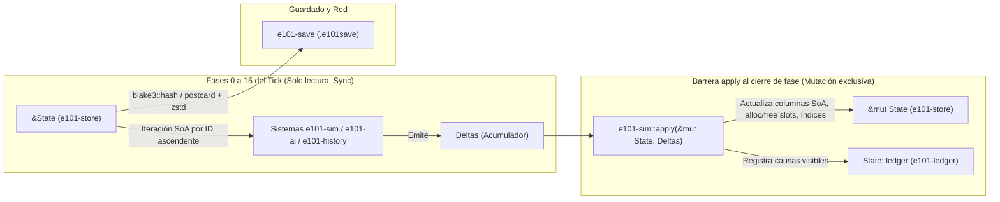

# Especificación técnica: Almacenamiento de estado, tablas SoA e identificadores (`e101-store`)

- **Estado:** `Propuesto`
- **Versión:** 1.0
- **Crates afectados:** `e101-store` (principal), `e101-time`, `e101-commands`, `e101-ledger`, `e101-sim`, `e101-save`
- **Referencias del documento maestro:** `docs/master/101_Agents_Games_Documento_Maestro_v0.7.md` (§§ 04, 09, 10, 11, 12, 13, 16, 21, 22, 23; Anexos P, T, W, X, AC, AG, AI, AR)
- **Decisiones de arquitectura relacionadas:** [ADR 0001](../adr/0001-monorepo-and-crate-graph.md), [ADR 0002](../adr/0002-determinism-rules.md), [ADR 0003](../adr/0003-fixed-point-types.md), [ADR 0004](../adr/0004-tick-schedule-and-state-hash.md)
- **Tareas relacionadas:** `T-104` (aritmética de punto fijo), `T-105` (tablas SoA e identificadores tipados)

---

## 1. Objetivo

El crate `e101-store` define la representación en memoria de todo el estado persistente del mundo (`State`), las primitivas numéricas de punto fijo (`Money`, `Qty`, `Ratio`, detalladas en [`fixed-point.md`](./fixed-point.md)), las colecciones tabulares orientadas a datos (*Structure of Arrays*, SoA) y los identificadores fuertemente tipados (`Id<T>` y slotmaps generacionales) que referencian cada entidad del juego (§§ 21, 22; Anexo X).

Su objetivo arquitectónico es triple:

1. **Rendimiento predecible y localidad de caché (§§ 09, 21, 22):** En una campaña de 760 años (277.400 días) con hasta 200.000 cohortes en escala L (~30 MB) y 17.500 en escala S (<3 MB), almacenar cada atributo en un vector contiguo (`Vec<Col>`) indexado por la misma clave permite que los sistemas de simulación recorran únicamente las columnas que leen, maximizando el aprovechamiento de líneas de caché L1/L2 (64 bytes), la vectorización automática del compilador y el paralelismo de solo lectura mediante `rayon` ([ADR 0001](../adr/0001-monorepo-and-crate-graph.md), [ADR 0004](../adr/0004-tick-schedule-and-state-hash.md)).
2. **Determinismo de recorrido e inmunidad al problema ABA (§ 04, Anexo AC, [ADR 0002](../adr/0002-determinism-rules.md)):** Garantizar que el orden de iteración sobre cualquier conjunto de entidades dependa exclusivamente del orden numérico ascendente de sus identificadores, nunca de direcciones de memoria ni de hashes aleatorios, y que el reciclaje de ranuras de entidades dinámicas (cohortes, ejércitos, personajes, tratados, guerras) detecte y rechace referencias obsoletas mediante contadores de generación.
3. **Inmutabilidad estructural durante el tick y serialización canónica (§ 21, Anexo X, [ADR 0003](../adr/0003-fixed-point-types.md), [ADR 0004](../adr/0004-tick-schedule-and-state-hash.md)):** Exponer una vista compartida `&State` (`Sync`) a las fases 0 a 15 del bucle diario y restringir toda mutación, alta o baja de filas a la barrera `e101-sim::apply` al cierre de cada fase, asegurando al mismo tiempo una representación en memoria directamente serializable de forma bit a bit determinista con `postcard` y `BLAKE3`.

---

## 2. Alcance y fuera de alcance

### Dentro del alcance (`e101-store`)

- La estructura raíz `State` que agrupa todas las tablas del motor (§ 21, Anexo X líneas 8439–8450, Anexo AR línea 9787).
- Los tipos de identificadores fuertemente tipados `Id<T>` (para tablas densas estáticas) y los identificadores con validación generacional para tablas dinámicas con ciclo de vida de creación/borrado (§ 09 línea 2119, § 22 línea 4900, Anexo X líneas 8425–8434).
- Los contenedores tabulares genéricos:
  - `DenseTable<K, V>`: columna contigua indexada por `Id<K>` sin huecos (`0..len`), usada tanto para columnas SoA individuales como para tablas de catálogos y geografía.
  - `SlotTable<K, RowMeta>` y columnas asociadas con mapa de ranuras generacionales (*generational slotmap*), para entidades dinámicas que nacen, se fusionan o se destruyen durante la partida.
- El esquema columnar completo de las tablas de dominio: `MapTables` (§ 08), `EntityTables` (§§ 11, 12), `CohortTables` (§ 09), `EconomyTables` (§ 10), `PoliticsTables` (§ 11), `DiplomacyTables` (§ 12), `MilitaryTables` (§ 13), `CharacterTables` (§ 11), `HistoryTables` (§ 16) y `AiMemoryTables` (§ 15, Anexo AR).
- Los índices secundarios deterministas mantenidos por `apply` (p. ej. `province_cohorts`, `province_armies`, `market_provinces`, `entity_provinces`) y la tabla de acumulación previa al umbral `pending_flows` (§ 09 líneas 2143–2156).
- Los traits y cursores de iteración determinista por ID ascendente (`ids()`, `iter_by_id()`) y el trait `StaggerKey` compartido con `e101-time` (Anexo X líneas 8405–8420).

### Fuera del alcance

- **Aritmética detallada de `Money`, `Qty` y `Ratio`:** reside en `e101-store::fixed`, pero su especificación formal, reglas de redondeo *half-to-even* y `allocate_exact` se documentan en [`docs/specs/fixed-point.md`](./fixed-point.md).
- **Fórmulas de negocio y cálculo de deltas:** los sistemas que leen `&State` y emiten `Deltas` pertenecen a `e101-sim`, `e101-history` y `e101-ai` (§ 21).
- **Definición de la cola de comandos y validadores previos:** pertenecen a `e101-commands` (`Command`, `StampedCommand`, Anexo X líneas 8516–8545).
- **Compresión y formato de archivo `.e101save` en disco:** la envoltura con cabecera mágica, `zstd` y suma `blake3` pertenece a `e101-save` (§ 21, [ADR 0004](../adr/0004-tick-schedule-and-state-hash.md)), aunque `State` implementa `serde::Serialize` y `serde::Deserialize` de forma canónica.
- **Estructuras espaciales de renderizado (quadtrees de cámara, mallas GPU, texturas SDF):** pertenecen exclusivamente al cliente gráfico `e101-client` y `e101-gfx` (§ 21; Regla 5 de `AGENTS.md`).

---

## 3. Modelo

### 3.1. Justificación de la arquitectura SoA (*Structure of Arrays*)

En un diseño tradicional orientado a objetos (*Array of Structures*, AoS), una cohorte demográfica u hogar se almacena como un único `struct Cohort` de ~150 bytes. Cuando un sistema mensual como la evolución de la alfabetización (§ 09) o el ajuste semanal de salarios (§ 10) necesita leer únicamente `size`, `occupation` y `literacy`, cada línea de caché de 64 bytes cargada desde la RAM trae consigo decenas de bytes irrelevantes (`origin`, `support`, `age_share`, etc.), desperdiciando más del 75 % del ancho de banda de memoria.

En `e101-store`, cada tabla de dominio sigue el patrón **SoA (*Structure of Arrays*)** (§ 09 línea 2137, § 21 línea 4757, § 22 línea 4783):

```text
AoS (Prohibido en tablas masivas):
[ {prov, occ, size, lit, wealth, ...}, {prov, occ, size, lit, wealth, ...}, ... ]

SoA (Adoptado en e101-store):
province:   [ Prov(0), Prov(0), Prov(1), Prov(2), ... ]  <- DenseCol<CohortId, ProvinceId>
occupation: [ Occ(1),  Occ(3),  Occ(1),  Occ(2),  ... ]  <- DenseCol<CohortId, OccupationId>
size:       [ Qty,     Qty,     Qty,     Qty,     ... ]  <- DenseCol<CohortId, Qty>
literacy:   [ Ratio,   Ratio,   Ratio,   Ratio,   ... ]  <- DenseCol<CohortId, Ratio>
wealth:     [ Money,   Money,   Money,   Money,   ... ]  <- DenseCol<CohortId, Money>
```

Ventajas directas en el motor:

1. **Eficiencia de caché L1/L2:** Un vector de `Ratio` (`i32`, 4 bytes) empaqueta 16 elementos por cada línea de caché de 64 bytes; un vector de `Qty` o `Money` (`i64`, 8 bytes) empaqueta 8 elementos por línea.
2. **Paralelismo sin bloqueos (`Sync`):** Durante las fases 0 a 15 del tick, `&State` es inmutable. Múltiples hilos de `rayon` pueden recorrer distintas columnas (o particiones por provincia/mercado de las mismas columnas) en paralelo sin contención ni *false sharing* ([ADR 0004](../adr/0004-tick-schedule-and-state-hash.md)).
3. **Presupuesto de memoria acotado (§ 09 línea 2138, § 22 línea 4783):**
   - **Escala S (Tesalia/Egeo, 350 provincias, ~17.500 cohortes):** `< 3 MB` para `CohortTables`.
   - **Escala L (Eurasia/África, ~15.000 provincias, ~200.000 cohortes):** `~30 MB` para `CohortTables`, permitiendo que el estado completo del mundo (`< 128 MB`) resida cómodamente en memoria y que el hash de estado o guardado rápido se ejecute en decenas de milisegundos.

---

### 3.2. Estructura raíz `State`

Conforme al Anexo X (líneas 8439–8450) y al Anexo AR (línea 9787), todo el estado determinista de una partida vive en una única estructura jerárquica:

```rust
use serde::{Deserialize, Serialize};
use e101_time::TimeState;
use e101_ledger::Ledger;

#[derive(Clone, Debug, Serialize, Deserialize)]
pub struct State {
    pub time: TimeState,
    pub map: MapTables,
    pub entities: EntityTables,
    pub population: CohortTables,
    pub economy: EconomyTables,
    pub politics: PoliticsTables,
    pub diplomacy: DiplomacyTables,
    pub military: MilitaryTables,
    pub characters: CharacterTables,
    pub history: HistoryTables,
    pub ledger: Ledger,
    pub ai_memory: AiMemoryTables,
}
```

> [!IMPORTANT]
> Ningún dato que afecte al futuro de la simulación puede vivir fuera de `State` (por ejemplo, en variables estáticas, caches `thread_local!` o estructuras del cliente). Si la IA necesita recordar amenazas o planes entre ticks, debe almacenarlos en `State::ai_memory` (`AiMemoryTables`, Anexo AR línea 9787) mediante deltas aplicados en la fase `apply`.

---

### 3.3. Identificadores fuertemente tipados (`Id<T>`) y familias de tablas

Para impedir errores de indexación cruzada (como usar un `ProvinceId` para indexar la tabla de bienes o mercados), todo índice de tabla se encapsula en un tipo fantasma `Id<T>` definido en el Anexo X (líneas 8425–8430):

```rust
use std::cmp::Ordering;
use std::fmt;
use std::hash::{Hash, Hasher};
use std::marker::PhantomData;
use e101_time::StaggerKey;
use serde::{Deserialize, Serialize};

#[repr(transparent)]
#[derive(Serialize, Deserialize)]
#[serde(transparent)]
pub struct Id<T> {
    pub(crate) index: u32,
    #[serde(skip)]
    _marker: PhantomData<fn() -> T>,
}

impl<T> Id<T> {
    #[inline]
    pub const fn from_raw(index: u32) -> Self {
        Self {
            index,
            _marker: PhantomData,
        }
    }

    #[inline]
    pub const fn index(self) -> usize {
        self.index as usize
    }

    #[inline]
    pub const fn raw(self) -> u32 {
        self.index
    }
}

// Implementaciones manuales para no exigir que el marcador `T` implemente estos traits:
impl<T> Copy for Id<T> {}
impl<T> Clone for Id<T> {
    #[inline]
    fn clone(&self) -> Self { *self }
}
impl<T> PartialEq for Id<T> {
    #[inline]
    fn eq(&self, other: &Self) -> bool { self.index == other.index }
}
impl<T> Eq for Id<T> {}
impl<T> PartialOrd for Id<T> {
    #[inline]
    fn partial_cmp(&self, other: &Self) -> Option<Ordering> { Some(self.cmp(other)) }
}
impl<T> Ord for Id<T> {
    #[inline]
    fn cmp(&self, other: &Self) -> Ordering { self.index.cmp(&other.index) }
}
impl<T> Hash for Id<T> {
    #[inline]
    fn hash<H: Hasher>(&self, state: &mut H) { self.index.hash(state); }
}
impl<T> fmt::Debug for Id<T> {
    fn fmt(&self, f: &mut fmt::Formatter<'_>) -> fmt::Result {
        write!(f, "{}({})", std::any::type_name::<T>(), self.index)
    }
}
impl<T> StaggerKey for Id<T> {
    #[inline]
    fn stagger_key(&self) -> u64 {
        self.index as u64
    }
}
```

#### Dos familias de tablas e identificadores

El motor distingue dos categorías de entidades según su ciclo de vida durante la campaña:

| Familia | Contenedor base | Entidades que la usan | Características de acceso y ciclo de vida |
| --- | --- | --- | --- |
| **1. Tablas densas estáticas / de catálogo** | `DenseTable<T, V>` | `LocationId`, `ProvinceId`, `RegionId`, `SeaZoneId`, `MarketId`, `GoodId`, `CultureId`, `ReligionId`, `OccupationId`, `BuildingKindId`, `InstitutionId`, `TechId`, `LawCategoryId`, `LawOptionId`, `EntityId` | Conjunto fijado al compilar los datos o al iniciar el escenario (las entidades políticas `EntityId` nunca se borran del vector: pasan a estado `extinct = true` conservando su historia). Acceso directo $O(1)$ mediante `vec[id.index()]` sin comprobación de generación. |
| **2. Tablas dinámicas con slotmap generacional** | `SlotTable<T>` + `SlotCol<T, V>` | `CohortId`, `ArmyId`, `FleetId`, `CharacterId`, `TreatyId`, `WarId`, `SiegeId`, `LoanId` | Entidades que se crean, fusionan o destruyen miles de veces en 760 años (§ 09 línea 2119, § 22 línea 4900, Anexo X líneas 8432–8433). Reutilizan ranuras (`index`) mediante un contador `generation: NonZeroU32` para evitar crecimiento ilimitado de memoria y prevenir el problema ABA. |

#### Prevención del problema ABA mediante slotmaps generacionales

El **problema ABA** ocurre cuando un sistema, comando en vuelo, tratado o ejército guarda el identificador de una entidad dinámica (p. ej., la cohorte `index = 42` con generación `1`), dicha cohorte se fusiona o muere en el tick $t$, otra cohorte nueva reutiliza el `index = 42` en el tick $t+1$, y una referencia rezagada intenta operar sobre `index = 42` creyendo que sigue siendo la cohorte original.

Para impedirlo de raíz (§ 09 línea 2119, § 22 línea 4900):

1. Cada fila de una `SlotTable<T>` posee un encabezado de ranura (`SlotMeta`):
   ```rust
   use std::num::NonZeroU32;

   #[derive(Copy, Clone, Debug, PartialEq, Eq, Serialize, Deserialize)]
   pub struct SlotMeta {
       pub generation: NonZeroU32,
       pub occupied: bool,
   }
   ```
2. Cada identificador o referencia externa a una tabla dinámica transporta (o valida contra la tabla) la dupla `(index: u32, generation: NonZeroU32)`:
   ```rust
   #[derive(Copy, Clone, PartialEq, Eq, PartialOrd, Ord, Hash, Serialize, Deserialize)]
   pub struct GenId<T> {
       pub(crate) index: u32,
       pub(crate) generation: NonZeroU32,
       #[serde(skip)]
       _marker: PhantomData<fn() -> T>,
   }
   ```
   *(Véase la Sección 10 para la unificación de alias entre `Id<T>` y `GenId<T>` en el Anexo X).*
3. Al consultar `table.get(id)`:
   - Se verifica `id.index < slots.len()`.
   - Se verifica `slots[id.index].occupied && slots[id.index].generation == id.generation`.
   - Si cualquiera de las dos condiciones falla, `get(id)` devuelve `None` (y en el validador de comandos de `e101-commands` rechaza el comando con `InvalidTarget`, sin provocar pánico ni corromper otra entidad).

```mermaid
stateDiagram-v2
    [*] --> NuevoSlot: alloc() sin huecos libres (gen = 1, occupied = true)
    NuevoSlot --> Libre: free(id) en fase apply (occupied = false)
    Libre --> Reocupado: alloc() toma menor index libre (gen = gen + 1, occupied = true)
    Reocupado --> Libre: free(id) en fase apply (occupied = false)
    Libre --> Retirado: gen alcanza u32::MAX (no vuelve a free_list)
```

---

### 3.4. Ciclo de vida de las entidades dinámicas

Todas las operaciones que alteran la ocupación de una `SlotTable<T>` están prohibidas durante la ejecución de los sistemas de las fases 0 a 15 del tick y **solo pueden ejecutarse dentro de la barrera `e101-sim::apply` ([ADR 0004](../adr/0004-tick-schedule-and-state-hash.md))**.

#### 1. Creación (`alloc` determinista en `apply`)
- `SlotTable<T>` mantiene un conjunto ordenado de ranuras libres: `free_indices: BTreeSet<u32>` (o un *min-heap* determinista serializado como `Vec<u32>` ordenado).
- Cuando `apply` procesa un delta de creación:
  - Si `free_indices` no está vacío, extrae el **menor `index` disponible** (`pop_first()`). Esto garantiza que la asignación sea 100 % determinista y mantenga las tablas compactas hacia los índices bajos.
  - Incrementa la generación de esa ranura (`generation = generation.checked_add(1)`) y marca `occupied = true`.
  - Si `free_indices` está vacío, añade una nueva posición al final de `slots` y de cada columna SoA con `generation = NonZeroU32::MIN` (`1`) y `occupied = true`.
- Inserta el nuevo identificador en los índices secundarios correspondientes (p. ej. `province_cohorts[prov]`) manteniendo el vector ordenado ascendentemente.

#### 2. Creación diferida de cohortes por umbral (`pending_flows`, § 09 líneas 2143–2156)
- La migración diaria o conversión semanal a menudo mueve menos personas que el umbral de creación de una cohorte (`pop.cohort.create_threshold = 50` personas).
- Crear cohortes de 2 o 5 personas dispararía el número de filas y forzaría su fusión inmediata al mes siguiente.
- Por ello, `CohortTables` incluye una tabla determinista `pending_flows: BTreeMap<PendingCohortKey, Qty>` donde:
  ```rust
  #[derive(Copy, Clone, Debug, PartialEq, Eq, PartialOrd, Ord, Hash, Serialize, Deserialize)]
  pub struct PendingCohortKey {
      pub province: ProvinceId,
      pub occupation: OccupationId,
      pub culture: CultureId,
      pub religion: ReligionId,
      pub legal_status: LegalStatus,
  }
  ```
- Si en la provincia destino ya existe una cohorte con esa misma tupla `(province, occupation, culture, religion, legal_status)`, el flujo se suma directamente a su `size`.
- Si no existe ninguna cohorte compatible y el flujo es $< 50$ personas (`Qty::from_int(50)`), se acumula en `pending_flows[key]`.
- En el instante en que `pending_flows[key] >= Qty::from_int(50)` (o al recibir un flujo directo $\ge 50$), `apply` invoca `alloc` en `CohortTables`, crea la nueva cohorte con el total acumulado y elimina la entrada de `pending_flows`.

#### 3. Fusión y borrado (`merge` y `free` en `apply`, § 09 líneas 2143–2149)
- **Fusión mensual de cohortes pequeñas:** En el tick mensual demográfico, toda cohorte cuyo tamaño caiga por debajo de:
  $$\text{merge\_threshold}(P) = \max\left(100,\; 0{,}003 \times \text{Población}(P)\right)$$
  emite un `CohortDelta::Merge { source, target }` hacia la cohorte más afín de la misma provincia (misma ocupación y estatus jurídico; si hay varias, la de mayor tamaño; en caso de empate exacto, la de menor `CohortId`).
- **Conservación en la fusión:** `apply` transfiere íntegramente `size`, `wealth` y `mobilized` de `source` a `target`, y recalcula las medias ponderadas por población (`age_share`, `literacy`, `living_standard`, `grievance`, `support`) usando aritmética de punto fijo exacta sin crear ni destruir una sola persona ni moneda (§ 04 Invariante 1, § 09).
- **Liberación de la ranura (`free`):**
  1. Se limpian o ponen a cero los valores de la fila en las columnas SoA para evitar fugas de datos residuales en serialización.
  2. Se marca `slots[id.index].occupied = false`.
  3. Se elimina `id` de los índices secundarios (`province_cohorts[prov]`).
  4. Si `slots[id.index].generation < NonZeroU32::MAX`, se inserta `id.index` en `free_indices` (la generación se incrementará al reocupar o en el propio `free`, siempre que se haga en un único punto canónico; en `e101-store` se incrementa al hacer `free` si `< u32::MAX`, y si llega a `u32::MAX` la ranura queda permanentemente retirada y no se añade a `free_indices`).

---

### 3.5. Orden de iteración determinista por ID

Conforme a `AGENTS.md` (§ 3), Anexo X (línea 8570) y Anexo AC (línea 8903):

1. **Recorrido de tabla completa:** Tanto `DenseTable` como `SlotTable` exponen `pub fn ids(&self) -> impl Iterator<Item = Id<T>>` (o `GenId<T>`), que recorre el rango `0..self.slots.len()` en **orden estrictamente creciente de `index`**, devolviendo únicamente las ranuras con `occupied == true`.
2. **Índices secundarios ordenados:** Todo índice agrupado (como `province_cohorts: DenseTable<Province, Vec<CohortId>>` o `market_provinces: DenseTable<Market, Vec<ProvinceId>>`) mantiene sus vectores internos ordenados por `(index, generation)` ascendente. La inserción utiliza búsqueda binaria (`binary_search` + `insert`) y el borrado mantiene el orden relativo (`binary_search` + `remove`), nunca `swap_remove` desordenado.
3. **Prohibición de colecciones con orden dependiente de hash:** Ninguna estructura dentro de `State` puede ser `std::collections::HashMap` ni `HashSet` ([ADR 0002](../adr/0002-determinism-rules.md)). Cuando se requiere un mapa disperso (p. ej. `pending_flows`, relaciones bilaterales entre pares `(EntityId, EntityId)` o inventarios escasos), se utiliza `BTreeMap` cuya clave implementa `Ord` únicamente sobre los índices numéricos `u32`.

---

### 3.6. Esquema detallado de `CohortTables` y `EconomyTables`

#### `CohortTables` (§ 09 líneas 2117–2156)

Almacena todas las cohortes demográficas vivas del mundo en 15 columnas paralelas indexadas por `CohortId`, más la tabla de flujos pendientes y el índice por provincia:

```rust
#[derive(Clone, Debug, Serialize, Deserialize)]
pub struct CohortTables {
    /// Metadatos de ocupación y generación de cada ranura de cohorte.
    pub slots: SlotTable<Cohort>,

    // --- 15 columnas SoA indexadas por CohortId.index() ---
    /// 1. Provincia de residencia actual.
    pub province: Vec<ProvinceId>,
    /// 2. Ocupación (campesinos libres, siervos, esclavos, artesanos, mercaderes, clero, nobles, soldados, eruditos).
    pub occupation: Vec<OccupationId>,
    /// 3. Cultura primaria.
    pub culture: Vec<CultureId>,
    /// 4. Religión confesional.
    pub religion: Vec<ReligionId>,
    /// 5. Estatus jurídico (Libre, NoLibre, CiudadanoPleno, MinoríaTolerada, MinoríaPerseguida).
    pub legal_status: Vec<LegalStatus>,
    /// 6. Provincia de origen o última migración significativa (para memoria migratoria y diásporas).
    pub origin: Vec<ProvinceId>,
    /// 7. Tamaño total en personas (escala 1_000 = 1 persona). Invariante: >= 0.
    pub size: Vec<Qty>,
    /// 8. Distribución de edades: [0..14 (dependientes jóvenes), 15..54 (activos), 55+ (ancianos)].
    /// Invariante: age_share[i][0] + age_share[i][1] + age_share[i][2] == Ratio::ONE.
    pub age_share: Vec<[Ratio; 3]>,
    /// 9. Tasa de alfabetización en [0, Ratio::ONE].
    pub literacy: Vec<Ratio>,
    /// 10. Ahorro líquido acumulado de la cohorte en moneda de cuenta. Invariante: >= Money::ZERO.
    pub wealth: Vec<Money>,
    /// 11. Ingreso neto del último mes (puede ser negativo si desahorra).
    pub income_month: Vec<Money>,
    /// 12. Nivel de vida actual respecto a la cesta básica y de confort.
    pub living_standard: Vec<Ratio>,
    /// 13. Agravio acumulado en [0, Ratio::ONE].
    pub grievance: Vec<Ratio>,
    /// 14. Apoyo al régimen actual en [0, Ratio::ONE].
    pub support: Vec<Ratio>,
    /// 15. Hombres adultos actualmente movilizados en ejércitos o flotas. Invariante: 0 <= mobilized <= size * age_share[1].
    pub mobilized: Vec<Qty>,

    // --- Estructuras auxiliares deterministas ---
    /// 16. Acumulador de flujos migratorios/conversión menores que pop.cohort.create_threshold (50 personas).
    pub pending_flows: BTreeMap<PendingCohortKey, Qty>,
    /// Índice secundario: lista ordenada de CohortId residentes en cada provincia.
    pub by_province: DenseTable<Province, Vec<CohortId>>,
}
```

**Presupuesto de memoria por fila de `CohortTables`:**
- `SlotMeta` (8 B) + `ProvinceId` (4 B) + `OccupationId` (4 B) + `CultureId` (4 B) + `ReligionId` (4 B) + `LegalStatus` (1 B + pad) + `origin: ProvinceId` (4 B) + `size: Qty` (8 B) + `age_share: [Ratio; 3]` (12 B) + `literacy: Ratio` (4 B) + `wealth: Money` (8 B) + `income_month: Money` (8 B) + `living_standard: Ratio` (4 B) + `grievance: Ratio` (4 B) + `support: Ratio` (4 B) + `mobilized: Qty` (8 B) $\approx \mathbf{92\text{ bytes por cohorte}}$ en las columnas activas (más sobrecoste de índices secundarios, $< 150\text{ B}$ en total).
- En **escala S** (17.500 cohortes): $\approx 2{,}1\text{ MB}$ (`< 3 MB`).
- En **escala L** (200.000 cohortes): $\approx 24\text{ MB}$ (`~30 MB`).

#### `EconomyTables` (§ 10, Anexo T, Anexo X)

Organiza la producción provincial, edificios productivos, mercados regionales, precios, stocks y rutas comerciales en tablas densas (el número de provincias $P$, mercados $M$ y bienes $G \in [28, 32]$ es fijo por catálogo):

```rust
#[derive(Clone, Debug, Serialize, Deserialize)]
pub struct EconomyTables {
    /// Número de bienes del catálogo activo (G, entre 28 y 32 en Epoch).
    pub goods_count: u32,

    // --- Tablas por Mercado (indexadas por MarketId) ---
    /// Centro comercial actual de cada mercado.
    pub market_center: DenseTable<Market, ProvinceId>,
    /// Provincias adscritas a cada mercado (ordenadas por ProvinceId).
    pub market_provinces: DenseTable<Market, Vec<ProvinceId>>,
    /// Matriz aplanada [market_idx * G + good_idx] de precios actuales P_{m,g} > Money::ZERO.
    pub prices: Vec<Money>,
    /// Matriz aplanada [market_idx * G + good_idx] de inventarios disponibles S_{m,g} >= Qty::ZERO.
    pub stockpiles: Vec<Qty>,
    /// Matriz aplanada [market_idx * G + good_idx] de oferta agregada de la última semana.
    pub weekly_supply: Vec<Qty>,
    /// Matriz aplanada [market_idx * G + good_idx] de demanda efectiva de la última semana.
    pub weekly_demand: Vec<Qty>,
    /// Liquidez y capital mercantil operativo en el mercado.
    pub market_capital: DenseTable<Market, Money>,

    // --- Tablas por Provincia (indexadas por ProvinceId) ---
    /// Mercado al que pertenece cada provincia (actualizado mensualmente con histéresis del 10 %).
    pub province_market: DenseTable<Province, MarketId>,
    /// Nivel de edificios por provincia y tipo [prov_idx * B + building_kind_idx].
    pub building_levels: Vec<u16>,
    /// Salario local semanal por provincia y ocupación [prov_idx * O + occ_idx].
    pub local_wages: Vec<Money>,
    /// Tierra cultivable total y tierra en uso en cada provincia.
    pub arable_land_total: DenseTable<Province, Qty>,
    pub arable_land_used: DenseTable<Province, Qty>,

    // --- Rutas comerciales inter-mercado ---
    /// Flujos activos entre pares de mercados ordenados por (from, to, good).
    pub trade_flows: BTreeMap<(MarketId, MarketId, GoodId), Qty>,
}
```

El acceso a matrices bidimensionales densas $[M \times G]$ o $[P \times B]$ se realiza mediante un método auxiliar `market_good_idx(m: MarketId, g: GoodId) -> usize` que calcula `m.index() * (self.goods_count as usize) + g.index()`, evitando vectores anidados (`Vec<Vec<Money>>`) que romperían la contigüidad de caché y añadirían indirecciones de puntero.

---

### 3.7. Resumen de las restantes tablas de `State`

| Tabla en `State` | Identificador primario | Contenido principal en SoA | Referencia |
| --- | --- | --- | --- |
| `MapTables` | `LocationId`, `ProvinceId`, `SeaZoneId` | Topología del grafo de adyacencia, terreno, clima, elevación, costas, ríos, humedad estacional, devastación, infraestructura viaria y portuaria. | § 08 |
| `EntityTables` | `EntityId` | Nombre/tag, capital (`ProvinceId`), rango político, tesorería (`Money`), deuda (`Money`), legitimidad (`Ratio`), estabilidad (`Ratio`), prestigio (`Ratio`), capacidad administrativa, bandera `extinct: bool`. | §§ 10, 11 |
| `PoliticsTables` | `EntityId`, `EstateId` | Influencia, lealtad y privilegios de los 5 estamentos por entidad (`[EntityId × 5]`), leyes activas por categoría (`[EntityId × LawCategory]`), autonomía, control e integración por provincia (`DenseTable<Province, Ratio>`), progresión de instituciones (`[ProvinceId × InstitutionId]`). | §§ 11, 14 |
| `DiplomacyTables` | `TreatyId`, `WarId` | `SlotTable<Treaty>` (partes, tipo, fecha de expiración), `SlotTable<War>` (atacantes, defensores, objetivo, puntuación de guerra `Ratio`, agotamiento bélico), matriz dispersa de relaciones y treguas `BTreeMap<(EntityId, EntityId), RelationState>`. | § 12 |
| `MilitaryTables` | `ArmyId`, `FleetId`, `SiegeId` | `SlotTable<Army>` (ubicación `LocationId`, propietario `EntityId`, comandante `Option<CharacterId>`, efectivos por tipo `[Qty; UnitKind]`, moral `Ratio`, organización `Ratio`, suministro cargado `Qty` de grano/armas, orden de marcha), `SlotTable<Fleet>`, `SlotTable<Siege>`. | § 13 |
| `CharacterTables` | `CharacterId` | `SlotTable<Character>` (nombre localizado, edad en días, entidad, rol activo: Gobernante, Heredero, Comandante, Consejero, Pretendiente, Rebelde; rasgos acotados `[TraitId; 3]`, competencia administrativa/diplomática/militar, lealtad `Ratio`, salud `Ratio`). Máximo ~12 personajes activos por entidad (§ 11). | § 11 |
| `HistoryTables` | `EventInstanceId` | Registro de cadenas de eventos activas, banderas históricas disparadas (`BTreeSet<EventId>`), tiempos de enfriamiento (`BTreeMap<(EventId, EntityId), Tick>`). | § 16 |
| `AiMemoryTables` | `EntityId` | Evaluación estratégica mensual por entidad IA: postura actual, objetivos prioritarios, reservas deseadas y memoria de agravios/amenazas (`DenseTable<Entity, AiStrategicMemory>`). | § 15, Anexo AR |

---

## 4. Parámetros iniciales

Los siguientes parámetros gobiernan el dimensionamiento, umbrales de creación/fusión de filas y límites de capacidad en `e101-store` (§ 09, § 22, Anexo P):

| Clave de parámetro | Tipo | Valor inicial | Rango válido | Descripción y referencia |
| --- | --- | --- | --- | --- |
| `pop.cohort.create_threshold` | `Qty` | `50` personas (`50_000` mU) | `[10, 500]` | Umbral mínimo acumulado en `pending_flows` para asignar un nuevo `CohortId` (§ 09 línea 2145, Anexo P). |
| `pop.cohort.merge_threshold_min` | `Qty` | `100` personas (`100_000` mU) | `[20, 1_000]` | Mínimo absoluto por debajo del cual una cohorte se fusiona en el tick mensual (§ 09 línea 2143, Anexo P). |
| `pop.cohort.merge_threshold_prov_share` | `Ratio` | `0.0030` (`0,30 %`) | `[0.0005, 0.0200]` | Fracción de la población provincial que define el umbral relativo de fusión: $\max(100, 0{,}003 \times \text{Pob}(P))$ (§ 09 línea 2143). |
| `store.capacity.cohorts_scale_s` | `u32` | `32_768` | `[4_096, 131_072]` | Capacidad pre-reservada (`Vec::with_capacity`) para columnas de `CohortTables` en escenarios de escala S (~17.500 cohortes esperadas, § 09). |
| `store.capacity.cohorts_scale_l` | `u32` | `262_144` | `[65_536, 1_048_576]` | Capacidad pre-reservada para columnas de `CohortTables` en escenarios de escala L (~200.000 cohortes esperadas, § 09, § 22). |
| `store.capacity.max_characters_per_entity` | `u32` | `12` | `[6, 24]` | Límite blando de personajes activos por entidad política para acotar el tamaño de `CharacterTables` (§ 11). |
| `store.limits.max_slot_index` | `u32` | `16_777_216` ($2^{24}$) | Fijo | Límite superior de seguridad en `SlotTable::alloc` para detectar fugas de entidades antes de agotar la memoria. |

---

## 5. Invariantes

`e101-store` impone y verifica (mediante `State::check_invariants(&self) -> Result<(), InvariantError>` en modo debug, pruebas doradas y 101 Lab) los siguientes invariantes estructurales y de negocio (§ 04, § 09, § 10, Anexo AC):

1. **Sincronía de longitud de columnas SoA (`SoAColumnLengthSync`):**
   - En toda tabla SoA (p. ej. `CohortTables`), todas las columnas paralelas (`province`, `occupation`, `culture`, `religion`, `legal_status`, `origin`, `size`, `age_share`, `literacy`, `wealth`, `income_month`, `living_standard`, `grievance`, `support`, `mobilized`) tienen exactamente la misma longitud que `slots.len()`.
   - En `EconomyTables`, `prices.len() == stockpiles.len() == weekly_supply.len() == weekly_demand.len() == market_center.len() * (goods_count as usize)`.
2. **Validez referencial cruzada (`ReferentialIntegrity`):**
   - Todo `Id<T>` o `GenId<T>` almacenado en una columna de una fila ocupada (`occupied == true`) apunta a una entrada válida y ocupada en la tabla destino.
   - Si una fila está libre (`occupied == false`), su `CohortId` o `ArmyId` no aparece en ningún índice secundario (`by_province`, `EntityTables`, `MilitaryTables`).
3. **Biyección de índices secundarios (`SecondaryIndexBijection`):**
   - Para toda provincia $P$, el vector `population.by_province[P]` está estrictamente ordenado por `CohortId` ascendente, no contiene duplicados, y el conjunto unión $\bigcup_P \text{by\_province}[P]$ es exactamente igual al conjunto de todos los `CohortId` con `occupied == true` y `province[c] == P`.
4. **No negatividad y particiones exactas (`NonNegativeAndNormalized`):**
   - Para toda cohorte ocupada $c$:
     - `size[c] >= Qty::ZERO` y `wealth[c] >= Money::ZERO`.
     - `Qty::ZERO <= mobilized[c] <= size[c]`.
     - `age_share[c][0] + age_share[c][1] + age_share[c][2] == Ratio::ONE` (exactamente `10_000` diezmilésimas).
     - `literacy[c]`, `grievance[c]` y `support[c]` pertenecen al intervalo cerrado `[Ratio::ZERO, Ratio::ONE]`.
   - Para todo mercado $m$ y bien $g$:
     - `prices[m, g] >= Money::from_milli(1)` (estrictamente positivo) y `stockpiles[m, g] >= Qty::ZERO`.
5. **Monotonía de generación y ausencia de colisión ABA (`GenerationMonotonicity`):**
   - El campo `generation` de cualquier ranura `index` en una `SlotTable` nunca decrece a lo largo de una partida (`gen(t + 1) >= gen(t)`). Si alcanza `u32::MAX`, la ranura nunca vuelve a marcarse como `occupied = true`.
6. **Determinismo de serialización (`CanonicalRoundTrip`):**
   - Para cualquier `state: State` válido, `let bytes = postcard::to_allocvec(&state)?; let state2: State = postcard::from_bytes(&bytes)?;` produce un `state2` cuyos bytes re-serializados son idénticos bit a bit (`postcard::to_allocvec(&state2)? == bytes`) y cuyo hash `blake3` coincide exactamente ([ADR 0004](../adr/0004-tick-schedule-and-state-hash.md)).

---

## 6. Interacción con otros sistemas



1. **`e101-time` (§ 21, Anexo X):**
   - `State::time` almacena el `Tick` actual y la fecha de calendario.
   - `Id<T>` y `GenId<T>` implementan `e101_time::StaggerKey` (`self.index as u64`), permitiendo que `should_run_staggered(tick, cadencia, id)` reparta deterministamente la carga de cohortes, provincias o entidades entre los 7 días de la semana o los 30 días del mes sin concentrar picos de CPU el día 1.
2. **`e101-commands` (§ 21, Anexo X, [ADR 0004](../adr/0004-tick-schedule-and-state-hash.md)):**
   - Los comandos emitidos por la interfaz del jugador, la red o la IA referencian entidades mediante los tipos de `e101-store` (`EntityId`, `ProvinceId`, `ArmyId`, `CohortId`, `BuildingKindId`, etc.).
   - En la Fase 0 del tick, el validador de comandos consulta `&State` a través de `SlotTable::get(id)`. Si un `ArmyId` o `CharacterId` fue destruido en un tick anterior, la comprobación generacional lo rechaza limpiamente antes de ejecutar la lógica del sistema.
3. **`e101-sim` y la fase `apply` (§ 21, Anexo X, [ADR 0004](../adr/0004-tick-schedule-and-state-hash.md)):**
   - Todos los sistemas de simulación tienen la firma `fn run(state: &State, deltas: &mut Deltas)`. Ningún sistema puede obtener `&mut State` ni llamar a `SlotTable::alloc` o `free`.
   - Solo `e101-sim::apply(state: &mut State, deltas: Deltas)` muta las columnas de `e101-store`, ejecuta las fusiones/altas/bajas de `SlotTable`, actualiza `pending_flows` y mantiene ordenados los índices secundarios.
4. **`e101-ledger` (§ 04, § 21, Anexo X):**
   - `State::ledger` vive dentro de `State`. Cuando `apply` modifica cualquier columna visible para el jugador en `EntityTables`, `CohortTables`, `EconomyTables`, `PoliticsTables` o `MilitaryTables`, invoca `state.ledger.record(variable, delta, cause, source_id)` en la misma transacción.
5. **`e101-save` (§ 21, [ADR 0004](../adr/0004-tick-schedule-and-state-hash.md)):**
   - Toma `&State`, lo serializa con `postcard` y lo comprime con `zstd`. Dado que `e101-store` solo utiliza vectores (`Vec`), arreglos de tamaño fijo y `BTreeMap`/`BTreeSet` con claves numéricas deterministas, el flujo de bytes resultante depende exclusivamente del estado lógico y es idéntico entre Windows, Linux y macOS.
6. **`e101-client` (Vistas de interfaz, § 19, § 21):**
   - El cliente nunca muta `State` ni mantiene punteros crudos a sus vectores; construye modelos de vista (*view-models*) por copia ligera de las filas requeridas (p. ej. las cohortes de la provincia seleccionada mediante `state.population.by_province[prov_id]`).

---

## 7. Registro causal

`e101-store` es el contenedor pasivo de los datos y aloja la instancia de `Ledger` en `state.ledger`, pero **no inventa causas por sí mismo**: exige por diseño que toda mutación pase por `e101-sim::apply` acompañada de su metadato causal (`Cause` y `VariableId`, Anexo X líneas 8469–8512).

No obstante, las operaciones de ciclo de vida del propio almacén ejecutadas durante `apply` registran las siguientes trazas causales obligatorias en `state.ledger`:

| Operación en `e101-store` (durante `apply`) | Variable registrada (`VariableId`) | Causa (`Cause`) | Comportamiento contable |
| --- | --- | --- | --- |
| Promoción de `pending_flows` a nueva cohorte ($\ge 50$ personas) | `ProvincePopulation(prov)` | Causa original del flujo (`Migration`, `Conversion`, `Assimilation`) | La población provincial ya incluía o recibe el flujo con su causa exacta; la promoción desde `pending_flows` conserva la trazabilidad sin aparecer como "creación espontánea". |
| Fusión de cohorte pequeña (`size < merge_threshold`) | `CohortSize(target)`, `CohortWealth(target)` | `Cause::CohortMerge { source: CohortId }` | Suma exacta de `size`, `wealth` y `mobilized` de la cohorte absorbida; el cambio neto en la provincia es `0`. |
| Disolución / aniquilación de ejército (`ArmyTable::free`) | `Treasury(entity)`, `ProvincePopulation(origin)` | `Cause::Demobilization` o `Cause::BattleCasualties` | Ningún soldado ni unidad de grano/armas en `ArmyTables` desaparece al liberar el slot: los supervivientes regresan a `CohortTables::mobilized` y el equipo sobrante vuelve al mercado o al almacén estatal antes de `free(army_id)`. |

---

## 8. Interfaz de usuario

Aunque `e101-store` no depende de ninguna biblioteca gráfica (Regla 5 de `AGENTS.md`), sus estructuras de datos están diseñadas para alimentar directamente las vistas de inspección del jugador (§ 19) y del editor **101 Forge** (§ 23):

1. **Inspector de provincia y pestaña de Población (§ 09, § 19):**
   - Consulta `state.population.by_province[prov_id]` en $O(1)$ para obtener la lista ordenada de `CohortId` (normalmente entre 5 y 60 cohortes por provincia).
   - Muestra para cada cohorte sus columnas `occupation`, `culture`, `religion`, `legal_status`, `size`, `literacy`, `living_standard`, `grievance` y `support`, junto con el desglose causal del último mes procedente de `state.ledger`.
   - Muestra en una fila informativa separada los flujos en tránsito acumulados en `pending_flows` para esa provincia (si son $> 0$), explicando al jugador que se consolidarán en una cohorte propia al alcanzar `50` personas.
2. **Inspector de Mercado (§ 10, § 19):**
   - Indexa directamente las matrices planas de `EconomyTables` (`prices`, `stockpiles`, `weekly_supply`, `weekly_demand`) para el `MarketId` seleccionado y los $G$ bienes, en tiempo $O(G)$ sin recorrer el resto del mapa.
3. **Panel de diagnóstico y 101 Forge (§ 22, § 23):**
   - Expone métricas de ocupación de `SlotTable` (filas activas, ranuras libres en `free_indices`, memoria total por tabla en KB/MB y generación máxima alcanzada) y el botón de ejecución manual de `state.check_invariants()` para depuración de mods y escenarios.

---

## 9. Pruebas y escenarios

Las pruebas de `e101-store` se ejecutan con `cargo xtask test e101-store` y forman parte de `cargo xtask check` (§ 22, Anexo AG):

### 9.1. Pruebas unitarias
1. **Propiedades de `Id<T>` y `GenId<T>` (`id_traits_and_ordering`):**
   - Verifica que `Id<DummyNonCloneType>` implementa `Copy`, `Clone`, `Eq`, `Ord`, `Hash` y `StaggerKey` sin requerir que `DummyNonCloneType` los implemente.
   - Verifica que el orden de `Id<T>` coincide exactamente con el orden de `index: u32`.
2. **Prevención del problema ABA en `SlotTable` (`slot_table_aba_protection`):**
   - Crea una entidad en la ranura `0` (`gen = 1`), guarda su `id_v1`.
   - Libera `id_v1` mediante `free(id_v1)`. Verifica que `get(id_v1)` devuelve `None`.
   - Crea una nueva entidad; verifica que reutiliza el índice `0` con `gen = 2` (`id_v2`).
   - Verifica que `get(id_v1)` **sigue devolviendo `None`** mientras que `get(id_v2)` devuelve `Some(...)`.
3. **Determinismo de reutilización de huecos (`slot_table_deterministic_lowest_free_index`):**
   - Asigna 10 elementos (`0..10`), libera los índices `7`, `2` y `5` en distinto orden en dos instancias de `SlotTable`.
   - Realiza 3 nuevas asignaciones en ambas instancias y comprueba que ambas asignan exactamente los índices `2`, luego `5`, luego `7`, y que `ids()` devuelve siempre `[0, 1, 2, 3, 4, 5, 6, 7, 8, 9]` en orden estrictamente ascendente.
4. **Retirada segura al saturar generación (`slot_table_generation_saturation`):**
   - Fuerza en una prueba unitaria una ranura con `generation == NonZeroU32::MAX`, la libera con `free` y comprueba que no se añade a `free_indices` y que la siguiente llamada a `alloc` utiliza la ranura siguiente sin desbordar ni entrar en pánico.
5. **Umbral `pending_flows` y fusión de cohortes (`cohort_pending_flows_and_merge_conservation`):**
   - Añade tres flujos de `15`, `20` y `10` personas (`45` en total) a una combinación `(prov, occ, cult, rel, status)` inexistente: verifica que no se asigna ningún `CohortId` y que `pending_flows` registra `45`.
   - Añade `5` personas más (`50` en total): verifica que se crea exactamente una cohorte de `50` personas y la entrada de `pending_flows` desaparece.
   - Ejecuta la fusión de una cohorte de `80` personas en otra de `500` personas y verifica que la suma de `size`, `wealth` y `mobilized` antes y después de la fusión es idéntica hasta la milésima (`0` pérdida por redondeo) y que `age_share` sigue sumando exactamente `Ratio::ONE`.

### 9.2. Pruebas de propiedades (`proptest`)
- **Invariante de secuencias aleatorias de `alloc` / `free` / `merge`:**
  - Dada cualquier secuencia generada por `proptest` de hasta 5.000 operaciones sobre `CohortTables` (creaciones, flujos parciales, fusiones y borrados), tras cada paso `check_invariants()` devuelve `Ok(())`, el conjunto `by_province` coincide exactamente con las filas ocupadas, `ids()` está estrictamente ordenado y el viaje de ida y vuelta por `postcard` produce bytes idénticos bit a bit.

### 9.3. Benchmarks (`cargo xtask bench`)
- **Recorrido SoA sobre 200.000 cohortes (escala L):**
  - Benchmark de un pase completo de lectura sobre `size`, `occupation`, `literacy` y `living_standard` de 200.000 cohortes en `CohortTables`: objetivo `< 0,5 ms` en un solo hilo y `< 0,2 ms` con `rayon`, validando el presupuesto del tick diario/mensual (§ 22 línea 4783).

---

## 10. Preguntas abiertas

- **Abierto (`store-open-01` — Representación unificada o desdoblada de `Id<T>` y `GenId<T>` en el Anexo X):**
  El Anexo X (líneas 8425–8434) define `Id<T>` como un `#[repr(transparent)]` de 32 bits (`index: u32`) y define los alias `pub type ProvinceId = Id<Province>;`, `pub type CohortId = Id<Cohort>;`, `pub type ArmyId = Id<Army>;`, mientras que el cuerpo del documento maestro (§ 09 línea 2119 y § 22 línea 4900) exige que las tablas con creación y borrado (`CohortId`, `ArmyId`, `CharacterId`, `TreatyId`, `WarId`) utilicen *slotmaps generacionales* con validación de generación para evitar colisiones ABA.
  Antes de cerrar la interfaz pública en `T-105`, el rol de Arquitectura debe confirmar mediante ADR o nota en el Anexo X cuál de las dos opciones canónicas se adopta:
  1. **Opción A (Desdoblamiento explícito de tipos, recomendada por eficiencia de caché):** Mantener `Id<T>` en 32 bits (`index: u32`) para todas las tablas densas estáticas (`LocationId`, `ProvinceId`, `MarketId`, `GoodId`, `CultureId`, `ReligionId`, `OccupationId`, `EntityId`, que representan más del 90 % de las claves foráneas por fila en `CohortTables`), y definir `GenId<T>` de 64 bits (`index: u32` + `generation: NonZeroU32`) para los alias de entidades dinámicas (`pub type CohortId = GenId<Cohort>;`, `pub type ArmyId = GenId<Army>;`, `pub type CharacterId = GenId<Character>;`).
  2. **Opción B (Empaquetado en 32 bits o 64 bits uniforme):** Mantener un único tipo `Id<T>` en todo el motor, ya sea de 64 bits para todas las entidades (`index: u32` + `generation: NonZeroU32`, donde las tablas estáticas usan siempre `generation = 1`) o de 32 bits empaquetados (p. ej. 20 bits de `index` —hasta 1.048.576 filas— y 12 bits de `generation` —4.095 reutilizaciones por slot—).
